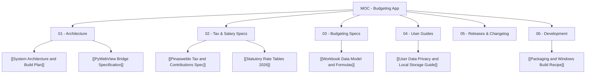

# Map of Content (MOC): Personal Budgeting & Philippine Salary Suite

Welcome to the central knowledge repository and technical specification vault for the **Personal Budgeting & Philippine Salary/Tax Desktop Application**.

---

## 📚 Vault Navigation Index

### 01 - Architecture
- [[System Architecture and Build Plan]]: Full component topology, technology stack (PyWebView + Bootstrap UI + PyInstaller), directory scaffolding, and execution lifecycle.
- [[PyWebView Bridge Specification]]: JSON-RPC IPC bridge contracts between Python backend mixins and JavaScript frontend.

### 02 - Tax & Salary Specifications (Reverse Engineered from Pinasweldo)
- [[Pinasweldo Tax and Contributions Spec]]: Full reverse-engineered documentation of BIR TRAIN Law withholding tax brackets, SSS contributions and MPF caps, PhilHealth 5% rates, Pag-IBIG salary limits, and 13th-month ₱90k exemption pool.
- [[Statutory Rate Tables 2026]]: Full tabular lookup tables for SSS Monthly Salary Credit (MSC), PhilHealth brackets, Pag-IBIG thresholds, and Regional Minimum Wage orders.

### 03 - Budgeting Specifications (Reverse Engineered from Dan BudgetingV3.xlsx)
- [[Workbook Data Model and Formulas]]: Analysis of all 11 workbook sheets, bi-weekly cutoff formulas with `NETWORKDAYS.INTL` holiday filtering, roommate utility splitting, shared ledger math, and privacy sanitization rules.

### 04 - User Guides & Privacy
- [[User Data Privacy and Local Storage Guide]]: Architectural guidelines ensuring zero cloud telemetry, 100% offline local storage, and strict separation between code and personal finances.

### 05 - Releases & Changelog
- `[[v0.2.0]]`: 100% workbook fidelity, Apt Expenses (6 sub-ledgers), Chore Chart, Pajah Rent, Master Settlement Matrix, and holiday loss deductions.
- `[[v0.1.0]]`: Initial scaffold, reverse-engineered specifications, and repository initialization.

### 06 - Development & Build Packaging
- [[Packaging and Windows Build Recipe]]: Step-by-step PyInstaller single-file `.exe` compilation, version resource embedding (`file_version_info.txt`), and code-signing instructions.
