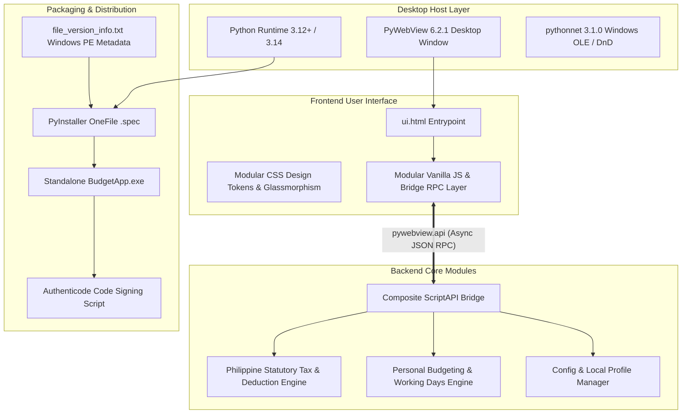

# System Architecture and Build Plan: Budgeting & Philippine Salary Suite

This document defines the technical architecture, UI layout, module breakdown, and implementation plan for the **Personal Budgeting & Philippine Salary/Tax Desktop Application**, replicating the proven architecture of `CVSU GENERATORS`.

---

## 1. High-Level Technology Stack

The application is built as a lightweight, zero-cloud-telemetry, 100% offline desktop application:



### Component Details
1. **Container / Desktop Wrapper**: `pywebview` 6.2.1 rendering Microsoft Edge WebView2 on Windows.
2. **Frontend UI Engine**: 100% offline, zero external CDN dependencies. Built with native HTML5, modular Vanilla JavaScript, and a tailored CSS design system (`tokens.css`, `base.css`, `layout.css`, `components.css`, `tables.css`, `modals.css`, `drawers.css`) with Apple HIG/Emerald glassmorphism supporting instant dark/light theme switching.
3. **Backend Service Layer**: Modular Python mixins (`BaseAPI`, `SalaryAPI`, `BudgetAPI`, `ConfigAPI`, `SystemAPI`) unified under `ScriptAPI`.
4. **Data Persistence**: Offline, user-owned JSON storage in Windows `%APPDATA%/PersonalBudgetApp/` or user-selected workspace files.
5. **Standalone Compilation**: `PyInstaller` single-file executable packaging with embedded PE version information (`file_version_info.txt`).

---

## 2. User Interface Layout & Wireframe

The UI follows the multi-view layout inspired by modern financial tools and the `CVSU GENERATORS` suite:

```text
+--------------------------------------------------------------------------------------------------+
| [Icon] Budgeting & Philippine Salary Suite   Release v0.1.0        [Theme] [Settings] [Docs/Help]|
+--------------------------------------------------------------------------------------------------+
|  [ 1. Salary & Tax ]  [ 2. Bi-Weekly Schedule ]  [ 3. Monthly Bills ]  [ 4. Settlements ]  [ 5. Dashboard ]  |
+--------------------------------------------------------------------------------------------------+
|                                                                                                  |
|  +-- Left: Input & Configuration Panel ---------+  +-- Right: Real-Time Results & Summary -----+  |
|  |                                              |  |                                           |  |
|  |  * Employment Type:                          |  |  ESTIMATED TAKE-HOME PAY (MONTHLY)        |  |
|  |    (o) Private  ( ) Gov't  ( ) Freelance     |  |  ₱ 45,210.50                              |  |
|  |                                              |  |                                           |  |
|  |  * Monthly Basic Pay:                        |  |  DEDUCTIONS BREAKDOWN                     |  |
|  |    [ ₱ 50,000.00                           ] |  |  - SSS Contribution:          ₱ 1,750.00  |  |
|  |                                              |  |    (Regular: ₱1,000 | MPF: ₱750)          |  |
|  |  * Pay Frequency:                            |  |  - PhilHealth (5%):           ₱ 1,250.00  |  |
|  |    (o) Monthly  ( ) Bi-Weekly / Cutoff       |  |  - Pag-IBIG (HDMF):           ₱   200.00  |  |
|  |                                              |  |  - BIR Withholding Tax:       ₱ 4,089.50  |  |
|  |  * Work Schedule (Teaching Units / Hours):  |  |  ---------------------------------------  |  |
|  |    Mon: 6h | Tue: 4h | Wed: 6h | Thu: 4h ... |  |  Total Statutory Deductions:  ₱ 7,289.50  |  |
|  |                                              |  |                                           |  |
|  |  * De Minimis / Non-Taxable Allowances:      |  |  DISCRETIONARY CASH FLOW AFTER EXPENSES   |  |
|  |    [ ₱ 3,000.00                            ] |  |  - Living Costs (Transpo/Food): ₱ 8,400.00|  |
|  |                                              |  |  - Shared Bills (Rent/Utils):  ₱ 9,250.00 |  |
|  |  * Daily Living Costs:                       |  |  =======================================  |  |
|  |    Transport: ₱150/day | Food: ₱250/day      |  |  NET AVAILABLE SURPLUS:       ₱ 27,560.50 |  |
|  +----------------------------------------------+  +-------------------------------------------+  |
|                                                                                                  |
+--------------------------------------------------------------------------------------------------+
| Ready | Engine: 2026 TRAIN Schedule | Storage: Local AppData | Profile: Default                  |
+--------------------------------------------------------------------------------------------------+
```

---

## 3. Directory Layout & Module Breakdown

```text
budgeting-app/
├── .agents/                        <- Governed AI skills & rules
├── .gitignore                      <- Strict gitignore (no spreadsheets, no user data)
├── AGENTS.md                       <- Workspace constitution & rules
├── requirements.txt                <- Aggregate dev dependencies
├── requirements-runtime.txt        <- pywebview, pythonnet, openpyxl
├── requirements-build.txt          <- pyinstaller
├── requirements-test.txt           <- pytest, playwright
├── app/
│   ├── main.py                     <- PyWebView desktop entrypoint & window lifecycle
│   ├── file_version_info.txt       <- Windows PE version metadata
│   ├── build.bat                   <- Automated PyInstaller compilation script
│   ├── budget_app.spec             <- PyInstaller build specification
│   ├── api/
│   │   ├── __init__.py             <- ScriptAPI composite class
│   │   ├── base.py                 <- BaseAPI with thread locks & lifecycle states
│   │   ├── salary.py               <- Salary & tax calculation endpoints
│   │   ├── budget.py               <- Bi-weekly schedule & living budget endpoints
│   │   ├── bills.py                <- Monthly bills & roommate splitter endpoints
│   │   ├── settlements.py          <- Peer-to-peer settlement ledger endpoints
│   │   ├── config.py               <- User preferences & profile persistence
│   │   └── system.py               <- Dialogs, file exports, diagnostics
│   ├── core/
│   │   ├── __init__.py
│   │   ├── tax_calculator.py       <- BIR TRAIN law & statutory contributions engine
│   │   ├── salary_engine.py        <- Gross/net, hourly rate, 13th month, overtime
│   │   ├── calendar_engine.py      <- NETWORKDAYS.INTL & Philippine holiday calendar
│   │   ├── bills_engine.py         <- Roommate bill splitting & rolling averages
│   │   └── settlement_engine.py    <- Reconciled peer settlements (Calumpang/Mama)
│   ├── ui.html                     <- Single-page desktop UI entrypoint
│   ├── css/
│   │   ├── tokens.css              <- Emerald / dark / light design tokens
│   │   ├── base.css                <- Typography, reset, accessibility
│   │   ├── layout.css              <- Grid, headers, navigation bars
│   │   ├── components.css          <- Badges, cards, buttons, form inputs
│   │   ├── tables.css              <- Financial tables, ledger grids
│   │   ├── modals.css              <- Dialogs & popups
│   │   └── drawers.css             <- Settings drawer, help panel
│   └── js/
│       ├── app.js                  <- App bootstrap & event wiring
│       ├── bridge.js               <- PyWebView bridge callers & event handlers
│       ├── state.js                <- Reactive frontend state store
│       ├── theme.js                <- Dark/light theme & accessibility switcher
│       ├── toast.js                <- Notification engine
│       ├── modal.js                <- Modal manager
│       ├── view_salary.js          <- Salary & tax calculator view
│       ├── view_schedule.js        <- Bi-weekly working days & schedule view
│       ├── view_bills.js           <- Monthly bills & roommate utility view
│       ├── view_settlements.js     <- Peer settlement & family remittance view
│       └── view_dashboard.js       <- Consolidated executive cash flow view
├── budgeting-app-documentation/    <- Obsidian knowledge vault
├── references/                     <- Reference spreadsheets & raw captures
└── tests/                          <- Automated test suite
    ├── test_tax_calculator.py      <- Test TRAIN, SSS, PhilHealth, Pag-IBIG parity
    ├── test_calendar_engine.py     <- Test working days with holidays
    ├── test_bills_engine.py        <- Test utility cost splitting & rolling avgs
    └── test_ui_consistency.py      <- Test version badges and frontend contracts
```

---

## 4. Phased Implementation Roadmap

- **Phase 1: Architecture & Reverse Engineering (Current Phase)**:
  - Reference architecture analysis, skill installation, `AGENTS.md` creation.
  - Complete reverse-engineering of Pinasweldo & `Dan BudgetingV3.xlsx` into Obsidian vault.
  - Strict `.gitignore` & Git initialization.
- **Phase 2: Core Engine Implementation**:
  - Implement `core/tax_calculator.py` with 100% mathematical parity against Pinasweldo.
  - Implement `core/calendar_engine.py` for bi-weekly cutoffs and Philippine holiday calendar.
  - Implement `core/bills_engine.py` and `core/settlement_engine.py`.
  - Comprehensive unit test suite in `tests/` verifying all calculations against Excel formula outputs.
- **Phase 3: PyWebView Bridge & UI Development**:
  - Implement `api/` composite mixins and `main.py`.
  - Build `ui.html`, modular CSS tokens, and JavaScript views with real-time reactive calculation.
  - Test end-to-end user workflows in the desktop window.
- **Phase 4: Packaging & Windows Executable Build**:
  - Configure `file_version_info.txt`, `budget_app.spec`, and `build.bat`.
  - Compile standalone single-file `BudgetApp.exe` and test clean execution.
