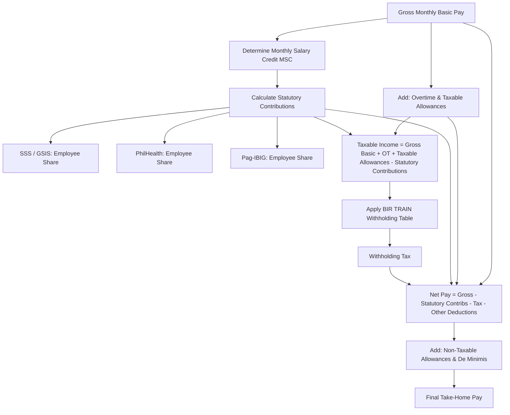

# Pinasweldo Tax and Contributions Specification

This specification documents the complete reverse-engineered statutory calculation engine and rate tables extracted from [Pinasweldo](https://pinasweldo.com) (2026 Rates).

## 1. Overview & Deduction Hierarchy

Net Take-Home Pay is calculated strictly in sequence:



---

## 2. Statutory Contributions (2026 Rates)

### 2.1 Social Security System (SSS) & Mandatory Provident Fund (MPF)
Under RA 11199 and SSS Circular 2024-006:
- **Total Contribution Rate**: 15% (Employee: 5.0%, Employer: 10.0%).
- **Minimum Monthly Salary Credit (MSC Floor)**: ₱5,000.
- **Maximum Monthly Salary Credit (MSC Ceiling)**: ₱35,000.
- **MSC Step Bracket**: ₱500 intervals.
- **Regular SSS Ceiling**: ₱20,000.
- **Mandatory Provident Fund (MySSS Pension Booster)**: Portion of MSC from ₱20,000 to ₱35,000.
- **Employees' Compensation (EC)**: Paid entirely by employer:
  - ₱10/mo if MSC < ₱15,000.
  - ₱30/mo if MSC >= ₱15,000.

#### Exact MSC Step Rounding Algorithm
```javascript
function getMsc(salary) {
  const mscFloor = 5000, mscCeiling = 35000, mscStep = 500;
  if (salary < mscFloor + mscStep / 2) return mscFloor;
  let steps = Math.floor((salary - (mscFloor - mscStep / 2)) / mscStep);
  return Math.min(mscCeiling, mscFloor + steps * mscStep);
}
```

#### Contribution Formulas
- `MSC = getMsc(BasicMonthlySalary)`
- **Regular SSS Employee**: `0.05 * min(MSC, 20000)` (Max: ₱1,000)
- **MPF Employee**: `0.05 * max(0, MSC - 20000)` (Max: ₱750)
- **Total SSS EE**: `Regular SSS EE + MPF EE = 0.05 * MSC` (Max: ₱1,750)
- **Employer SSS**: `0.10 * MSC` (Max: ₱3,500)
- **Employer EC**: `MSC < 15000 ? 10 : 30`

---

### 2.2 PhilHealth (Universal Health Care Act)
Under PhilHealth 2024–2026 advisory rates:
- **Premium Rate**: 5.0% of Monthly Basic Salary.
- **Monthly Salary Floor**: ₱10,000 (Min monthly contribution: ₱500).
- **Monthly Salary Ceiling**: ₱100,000 (Max monthly contribution: ₱5,000).
- **Sharing**: 50/50 equal split between employee and employer.
- **Employee Share**: `Math.min(100000, Math.max(10000, Salary)) * 0.05 / 2`
  - Min: **₱250.00/mo**
  - Max: **₱2,500.00/mo**
- **Employer Share**: Equal to employee share (`₱250.00` to `₱2,500.00/mo`).

---

### 2.3 Pag-IBIG Fund (Home Development Mutual Fund)
Under HDMF Circular 2024 (Effective February 2024 through 2026):
- **Maximum Fund Salary Cap**: ₱10,000.
- **Employee Contribution Rate**:
  - `1.0%` if Monthly Salary <= ₱1,500.
  - `2.0%` if Monthly Salary > ₱1,500.
- **Employer Contribution Rate**: `2.0%`.
- **Formulas**:
  - `FundSalary = Math.min(Salary, 10000)`
  - `EE_PagIBIG = (Salary <= 1500 ? 0.01 : 0.02) * FundSalary` (Max: **₱200.00/mo**)
  - `ER_PagIBIG = 0.02 * FundSalary` (Max: **₱200.00/mo**)
  - `Total Monthly Remittance`: Max **₱400.00/mo**.

---

## 3. BIR Income Tax (TRAIN Law RA 10963)

### 3.1 Annual Tax Schedule (Effective 2023 to Present)

| Bracket | Annual Taxable Income Range | Base Tax | Marginal Rate | Formula |
|:-------:|:---------------------------|:--------:|:-------------:|:--------|
| **1** | ₱0 to ₱250,000 | ₱0.00 | 0% | Tax Exempt |
| **2** | Over ₱250,000 to ₱400,000 | ₱0.00 | 15% | `15% of excess over ₱250,000` |
| **3** | Over ₱400,000 to ₱800,000 | ₱22,500.00 | 20% | `₱22,500 + 20% of excess over ₱400,000` |
| **4** | Over ₱800,000 to ₱2,000,000 | ₱102,500.00 | 25% | `₱102,500 + 25% of excess over ₱800,000` |
| **5** | Over ₱2,000,000 to ₱8,000,000 | ₱402,500.00 | 30% | `₱402,500 + 30% of excess over ₱2,000,000` |
| **6** | Over ₱8,000,000 | ₱2,202,500.00 | 35% | `₱2,202,500 + 35% of excess over ₱8,000,000` |

### 3.2 Periodic Withholding Tables (Semi-Monthly & Monthly)

#### Monthly Withholding Table:
- **Bracket 1**: Up to ₱20,833 $\rightarrow$ ₱0.00
- **Bracket 2**: ₱20,833 to ₱33,333 $\rightarrow$ `15% * (Income - 20833)`
- **Bracket 3**: ₱33,333 to ₱66,667 $\rightarrow$ `₱1,875.00 + 20% * (Income - 33333)`
- **Bracket 4**: ₱66,667 to ₱166,667 $\rightarrow$ `₱8,541.80 + 25% * (Income - 66667)`
- **Bracket 5**: ₱166,667 to ₱666,667 $\rightarrow$ `₱33,541.80 + 30% * (Income - 166667)`
- **Bracket 6**: Over ₱666,667 $\rightarrow$ `₱183,541.80 + 35% * (Income - 666667)`

#### Semi-Monthly Withholding Table (Bi-Weekly Payday):
- **Bracket 1**: Up to ₱10,417 $\rightarrow$ ₱0.00
- **Bracket 2**: ₱10,417 to ₱16,667 $\rightarrow$ `15% * (Income - 10417)`
- **Bracket 3**: ₱16,667 to ₱33,333 $\rightarrow$ `₱937.50 + 20% * (Income - 16667)`
- **Bracket 4**: ₱33,333 to ₱83,333 $\rightarrow$ `₱4,270.70 + 25% * (Income - 33333)`
- **Bracket 5**: ₱83,333 to ₱333,333 $\rightarrow$ `₱16,770.70 + 30% * (Income - 83333)`
- **Bracket 6**: Over ₱333,333 $\rightarrow$ `₱91,770.70 + 35% * (Income - 333333)`

---

## 4. 13th-Month Pay, De Minimis & Tax Exemption Pool

### 4.1 ₱90,000 Bonus Exemption Cap
- Under NIRC Sec. 32(B)(7)(e), total 13th-month pay and other bonuses/productivity incentives are **tax-free up to ₱90,000.00** annually.
- Any amount in excess of ₱90,000 is added directly to taxable income (typically in December payroll annualization).
- **Formula**:
  `TaxableBonusExcess = Math.max(0, Total13thAndBonuses - 90000)`

### 4.2 Pro-Rated 13th-Month Pay Formula
```text
13th_Month_Pay = (Total Basic Salary Earned in Year) / 12
```
If employed for $M$ full months at monthly basic $S$:
$$ \text{13th Month} = \frac{S \times M}{12} $$

### 4.3 De Minimis Benefits Limits (Exempt from Withholding)
- Rice Allowance: **₱2,500 / month** (₱30,000 / yr).
- Uniform / Clothing: **₱8,000 / year**.
- Laundry Allowance: **₱400 / month** (₱4,800 / yr).
- Medical Cash Allowance to Dependents: **₱333 / month** (₱4,000 / yr).
- Actual Medical Assistance: **₱12,000 / year**.
- Employee Achievement Awards: **₱12,000 / year**.
- Gifts / Christmas / Anniversary: **₱6,000 / year**.
- CBA & Productivity Incentive: **₱12,000 / year**.
- Daily Meal Subsidy: Up to **30% of Regional Minimum Daily Wage**.

---

## 5. Employment Types & Variations

1. **Private Employee**: Standard statutory split (SSS, PhilHealth, Pag-IBIG).
2. **Government Employee**:
   - Uses GSIS instead of SSS: Employee pays **9.0%**, Employer pays **12.0%**.
   - Tax-exempt PERA (Personnel Economic Relief Allowance): **₱2,000 / month**.
   - Standard SSL (Salary Standardization Law) Tranches 2024–2027.
3. **Kasambahay (Domestic Worker)**:
   - If salary < ₱5,000/mo: Employer pays 100% of SSS, PhilHealth, and Pag-IBIG (Employee pays ₱0).
4. **Freelancer / Self-Employed**:
   - Choice between **8% Gross Income Tax** (eligible if gross < ₱3,000,000, with ₱250,000 annual deduction) or **Graduated Rates + 3% Percentage Tax**.
   - Pays voluntary full contributions (15% SSS, 5% PhilHealth, 4% Pag-IBIG).
5. **Government Job Order / Contract of Service (COS/JO)**:
   - No GSIS, PERA, or 13th month from agency.
   - May receive up to 20% premium allowance.
   - Creditable withholding tax at 5% (or 10% / 2%).
