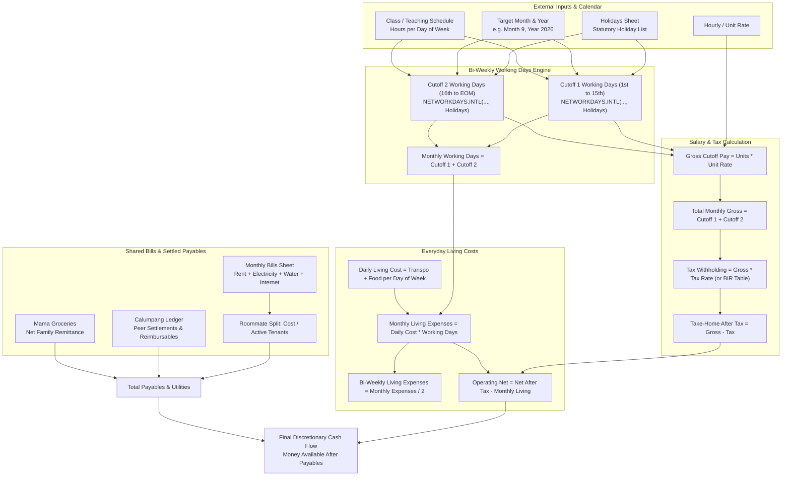
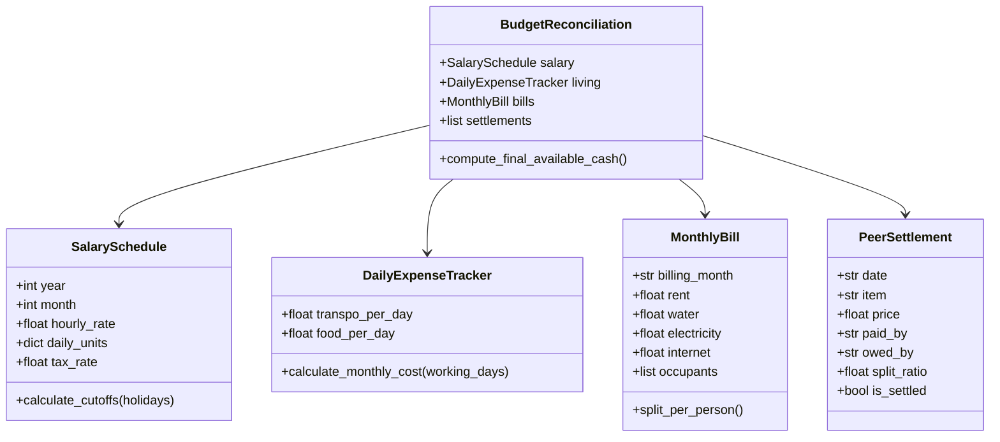

# Personal Budgeting Workbook Data Model & Calculation Specification

This document provides the reverse-engineered data model, formula algebra, sheet topology, and calculation pipelines extracted from `references/Dan BudgetingV3.xlsx`.

> [!NOTE]
> **Privacy Rule Compliance**: In accordance with `AGENTS.md`, all sensitive personal financial figures, account numbers, and personal names have been sanitized into schema abstractions and configurable parameters.

---

## 1. Sheet Architecture & Functional Taxonomy

The reference workbook comprises 11 sheets operating as a relational personal finance and shared expense settlement system:

| Sheet Name | Functional Category | Purpose / Responsibility |
|:-----------|:--------------------|:-------------------------|
| **`📊 Dashboard`** | Executive Summary & Bi-Weekly Model | Consolidates bi-weekly salary cutoffs, working days, daily transit/food expenses, utility deductions, and net cash flow available. |
| **`Monthly Bills`** | Recurring Bills & Utilities | Historical ledger of rent, water, electricity, and internet; dynamically divides costs among roommates with status tracking and 3-month rolling averages. |
| **`Apt Expenses`** | Shared Asset & Setup Purchases | Itemized ledger for apartment furnishings, groceries, hardware, and one-off application expenses with discount deductions. |
| **`Calumpang`** | Shared Settlement Ledger | Peer-to-peer expense ledger tracking who paid for what and who owes whom (Dan, Roommate A, Roommate B) with 50/50 division. |
| **`Mama Groceries`** | Family Remittance Ledger | Two-column ledger calculating gross remittances less deductions to compute the exact net transfer required. |
| **`Pajah Rent`** | Equipment & Apparel Rental | Tracks item owners, rental prices, add-on margins, and net payouts per participant. |
| **`Holidays`** | Statutory Calendar Reference | Complete calendar of Philippine Regular and Special Non-Working Holidays used by `NETWORKDAYS.INTL` to compute working days. |
| **`Lists`** | Lookups & Design Tokens | Master validation lists for statuses (`Paid`, `Pending`, `Complete`), rolling dates via `EDATE`, and status color hex codes. |
| **`Spotify`** | Subscription Detail | Ancillary group sharing cost breakdown. |
| **`Current Budget`** | Operational Scratchpad | Working budget snapshot synchronized with Dashboard. |
| **`Chore Chart`** | Household Logistics | Task allocation tracking. |

---

## 2. Calculation Flow & Data Pipeline



---

## 3. Detailed Formula Algebra & Cell Logic

### 3.1 Bi-Weekly Working Days & Holiday Filtering
The application dynamically computes working days per cutoff for each day of the week (Monday through Saturday) using seven-character binary day masks (`0` = working day, `1` = rest day) cross-referenced against `Holidays!$A$2:$A$100`:

- **Cutoff 1 (1st to 15th)**:
  ```excel
  =NETWORKDAYS.INTL(DATE(Year, Month, 1), DATE(Year, Month, 15), "0111111", Holidays!$A$2:$A$100) * Mon_Units
  + NETWORKDAYS.INTL(DATE(Year, Month, 1), DATE(Year, Month, 15), "1011111", Holidays!$A$2:$A$100) * Tue_Units
  + ...
  + NETWORKDAYS.INTL(DATE(Year, Month, 1), DATE(Year, Month, 15), "1111101", Holidays!$A$2:$A$100) * Sat_Units
  ```
- **Cutoff 2 (16th to End of Month)**:
  ```excel
  =NETWORKDAYS.INTL(DATE(Year, Month, 16), EOMONTH(DATE(Year, Month, 1), 0), "0111111", Holidays!$A$2:$A$100) * Mon_Units
  + ...
  ```

### 3.2 Dynamic Roommate Utility Cost Splitting (`Monthly Bills`)
Each bill row divides the total sum of utilities and rent among occupants who are marked active (`TRUE`):
```excel
=IF(TotalBill="", "", IFERROR(TotalBill / COUNTIF(Tenant1:Tenant3, TRUE), 0))
```
- If an occupant is away for that billing cycle (`FALSE`), the denominator automatically scales down without breaking spreadsheet formulas.

### 3.3 3-Month Rolling Utility Averages
Computes rolling expenditure trends for water, power, and internet:
```excel
=AVERAGE(OFFSET(UtilityColumnStart, COUNTA(UtilityColumn) - 3, 0, 3, 1))
```

### 3.4 Shared Ledger Division (`Calumpang`)
- **Shared Half**: `=ROUNDUP(ItemPrice / 2, 0)`
- **Individual Obligation**: `=IF(PaidCheckbox=1, 0, IndividualShare)`

### 3.5 Remittance Net Reconciliation (`Mama Groceries`)
```excel
NetTransfer = SUM(GroceriesAndObligations) - SUM(DeductionsAndCredits)
```

---

## 4. Proposed Desktop Software Data Model

To replicate and elevate this workbook into a modern Python + Bootstrap desktop application, the domain model will be structured as follows:


